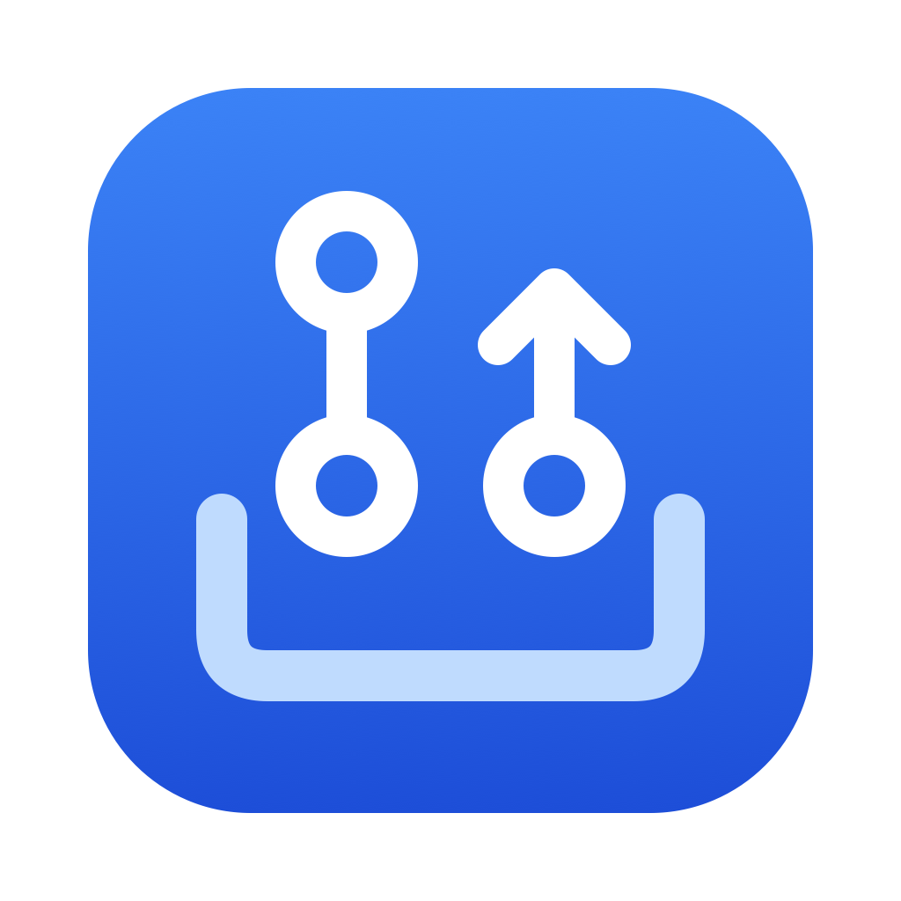
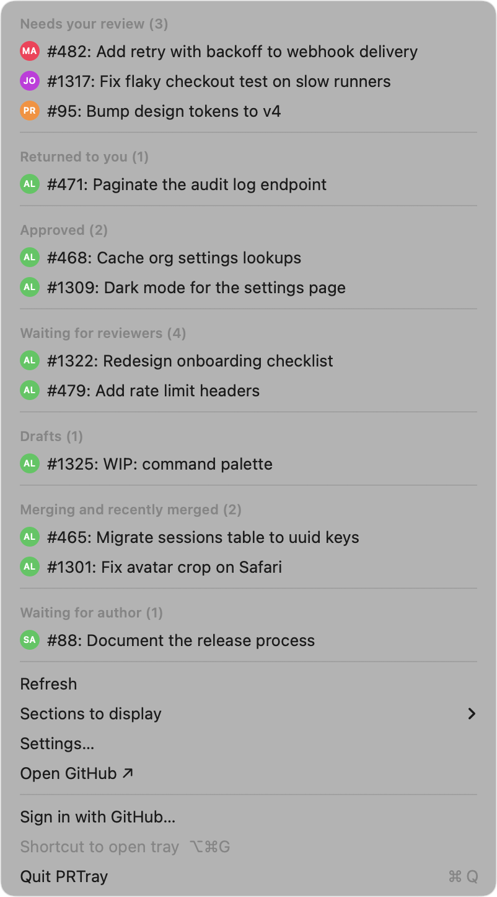

# PRTray

Graphite-style GitHub PR tray for your Mac menu bar, free and open source.

## Features

- One native menu, one line per PR, grouped like a review inbox: needs your review, returned to you, approved, waiting for reviewers, drafts, merging and recently merged, waiting for author.
- Menu bar badge with the number of PRs that need your attention.
- Notifications when a review is requested, changes are requested, a PR is approved, CI fails, or a PR is merged or closed.
- Pinned repos: list the repos you care about and they sort first in every section. An optional owner filter limits the tray to specific users or organizations.
- Global shortcut (Option-Command-G) to open the tray, launch at login, configurable polling.
- Sign in with GitHub in a few clicks. No `gh` required.
- Native SwiftUI, no Dock icon, macOS 14 or later.

## Install

Download the latest `PRTray.dmg` from [Releases](https://github.com/Akkikens/prtray/releases), open it, and drag PRTray to Applications.

Or with Homebrew (to be published):

    brew install --cask akkikens/tap/prtray

## Sign in

Choose **Sign in with GitHub...** from the tray. PRTray shows a one-time code; click **Copy code & open github.com/login/device**, paste the code, and approve. PRTray requests the `repo` and `read:org` scopes so it can list pull requests in private repos and your organizations.

If an organization restricts OAuth app access, an owner has to approve PRTray before its private PRs show up. You can request approval from [github.com/settings/applications](https://github.com/settings/applications), or ask an org owner to allow it under the organization's third-party access settings.

Developers who already use the GitHub CLI do not need to sign in: when there is no PRTray token in the Keychain, PRTray uses `gh auth token` automatically.

## Settings

Open **Settings...** in the tray to set pinned repos (a comma-separated list such as `acme/web, acme/api`) and an optional owner filter (such as `acme`).

## Build from source

Requires Xcode 16 or later and [XcodeGen](https://github.com/yonaskolb/XcodeGen) (`brew install xcodegen`).

    xcodegen generate
    xcodebuild -project PRTray.xcodeproj -scheme PRTray -configuration Release \
      -derivedDataPath build CODE_SIGN_IDENTITY=- build
    open build/Build/Products/Release/PRTray.app

To use your own GitHub OAuth App for sign-in, create one at github.com/settings/developers, enable **Device Flow**, and put its client ID in `project.yml` as `GitHubClientID`. The client ID is public by design; there is no client secret.

Run with `-demo` to see fake data (used for the screenshot):

    open build/Build/Products/Release/PRTray.app --args -demo

## Privacy

Your GitHub token stays in the macOS Keychain on your Mac. PRTray talks only to `api.github.com` (pull requests, avatars, update check) and `github.com` (sign-in). There is no analytics and no server of ours in between.

## License

MIT. See [LICENSE](LICENSE).
